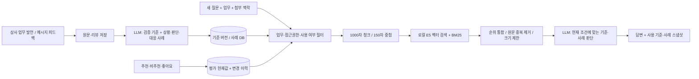

# KHALA 사례 RAG 구현

## 실행 흐름



## 저장하는 데이터

- `khala_chat_message`, `khala_chat_review`: 대화·리뷰 원문. 기존 기록을 덮어쓰지 않는다.
- `khala_chat_reaction`: 메시지별 담당 리뷰어의 추천/비추천 한 가지와 좋아요 독립 상태. 재요청해도 현재 값이 뒤집히지 않도록 `enabled` 값을 명시한다.
- `khala_reaction_event`: 평가 변경 전후의 감사 이력. 빠른 평가는 리뷰 완료나 지식 승인을 의미하지 않는다.
- `khala_knowledge`, `khala_knowledge_version`: 공통 검증 기준 및 불변 버전.
- `khala_rag_case`: 상사의 명시적 판단과 앞뒤 맥락을 LLM이 정리한 사례. 상황·문제/판단·대응, 원문 메시지·리뷰 연결, 근거 기준 버전을 보존한다. 단순 칭찬이나 AI의 답변만으로 공유 사례를 만들지 않는다.
- `khala_rag_embedding`: `모델 리비전 + 청크 내용`의 SHA-256을 키로 하는 벡터 캐시. 내용이 바뀌면 새 임베딩을 만든다.

이미 쌓여 있던 리뷰와 전문 발언도 조회 권한이 있는 사용자에게는 원문 기반 사례로 검색된다. 새 LLM 요약이 생성되면 정리된 사례로 대체한다. 아직 익명화하지 않은 대화·빠른 평가 사례는 해당 원문을 볼 수 있는 작성자와 담당 리뷰어에게만 검색된다. LLM이 정리한 공유 사례에는 이름·고유 수치·개인 식별 정보를 넣지 않도록 지시한다. 완전한 개인정보 제거를 보증하는 별도 DLP 기능은 아니다.

## 검색과 선택

1. 동일 업무의 활성 기준과 사례만 후보로 삼는다. 현재 대화 자체는 사례 검색에서 제외한다. 관련 기준이 중지되거나 버전이 바뀐 사례는 제외해 과거 판단을 현재 규칙처럼 재사용하지 않는다.
2. 긴 자료는 1,000자 조각으로 나누고 150자를 겹친다. 임베딩은 토큰 최대 512개, 384차원이다. 질의에는 `query:`, 자료에는 `passage:` 접두어를 쓴다. 로컬 ONNX 모델로 평균 풀링·L2 정규화한다. [원 모델의 사용법](https://huggingface.co/intfloat/multilingual-e5-small)을 따른다.
3. 한국어 부분어를 포함한 BM25와 정규화 벡터 내적(코사인 유사도)을 각각 계산한다. BM25 양수 결과와 코사인 0.65 이상 결과에서 각각 상위 40개를 취한다. 임계값은 초기 기본값으로, 실제 업무 평가셋을 통한 조정이 필요하다.
4. RRF `1/(60+순위)`를 합산하고 같은 원문 청크를 하나로 묶는다. 추천·비추천·좋아요는 결과를 최대 ±10% 범위에서 조정한다. 비추천 사례는 `rejected`로 전달해 피해야 할 예시로 취급한다. 좋아요만으로 정답·공통 기준이 되지 않는다.
5. 기준 최대 8개, 사례 최대 4개, 본문 총 10,000자 이내로 제한한다. LLM이 현재 업무·비교 조건·문제를 기준으로 후보를 다시 판단하고 실제 사용한 `usedMemoryIds`, `usedCaseIds`를 반환한다. 서버는 후보에 실제 존재하는 ID만 저장한다.
6. 대화 답변은 사용한 기준 버전과 사례 내용을 스냅샷으로 저장한다. 화면의 **참고한 유사 사례**와 **조직 경험 검색**에서 사용한 자료와 검색 상태를 확인한다. PDF 검증에는 같은 검색 결과를 전달하고 **AI 검증에 전달된 유사 사례**로 표시한다. PDF 표시는 전달된 후보 목록이며 각 사례의 실제 사용 여부를 단정하지 않는다.

현재 벡터는 PostgreSQL JSONB에 저장하고 업무로 좁힌 후보를 서버에서 정확 코사인 검색한다. ANN/HNSW 인덱스나 별도 벡터 검색 서버는 아직 사용하지 않는다. 대규모 코퍼스에서는 DB 벡터 인덱스로 옮겨야 한다. 현재는 첫 질의에서 필요한 청크를 순차 배치로 인덱싱하며 이후에는 내용 해시 캐시를 재사용한다.

## 장애와 설치

임베딩 실행 실패 시 BM25로 대체하고 답변의 검색 기록에 **단어 검색 / 의미 검색을 사용할 수 없음**을 남긴다. 의미 검색이 동작했다고 표시하지 않는다. 임베딩·LLM 실행은 DB 트랜잭션 밖에서 수행한다. 기준 갱신 시 버전이 달라졌으면 오래된 추출 결과를 덮어쓰지 않고 재시도를 안내한다.

이 PC에는 모델과 실행 의존성이 설치되어 있다. 다른 PC에서 설치하려면:

```powershell
python -m pip install -r scripts/rag-requirements.txt
python scripts/setup-rag.py
```

모델은 `.khala-models/multilingual-e5-small/`에 저장된다. 설치 스크립트는 공개 모델 파일만 다운로드하며 사용자 대화는 보내지 않는다. `manifest.json`에 원격 리비전과 파일 해시를 기록한다. 설치 후 임베딩 실행은 네트워크를 사용하지 않는다. `KHALA_PYTHON`으로 Python 실행 파일을 지정할 수 있다.

실제 답변 생성과 사례 요약은 요청자의 개인 설정 또는 조직·서버 기본 설정에 연결된 API 모델을 사용한다. 전체 대화 원문은 DB에 보존하고 모델에는 최근 20개 메시지와 누적 요약, 검색된 자료를 전달한다.
